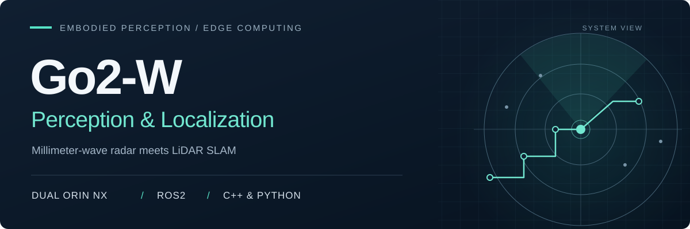
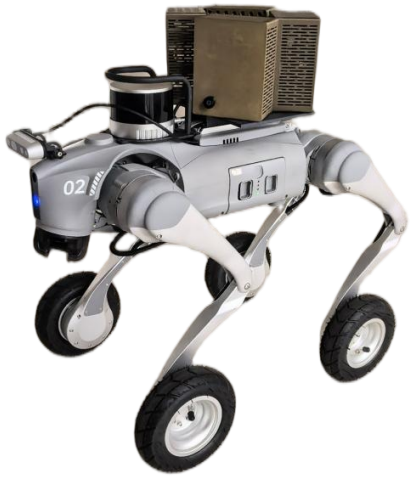
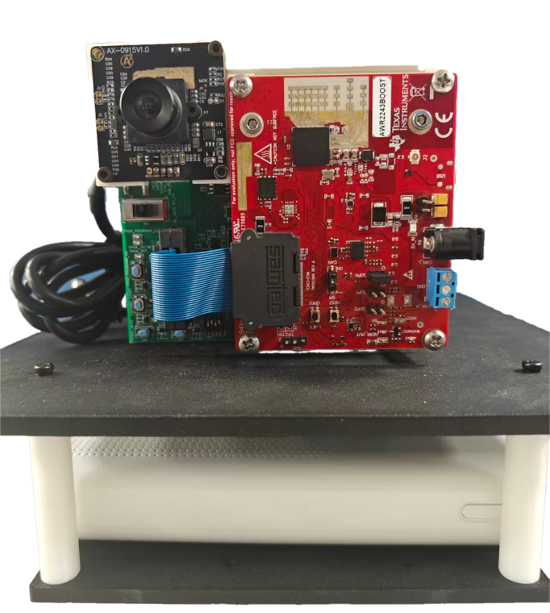
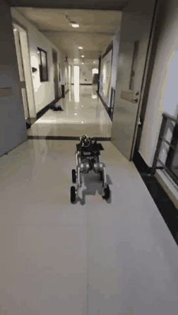
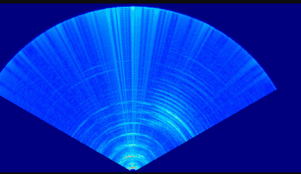
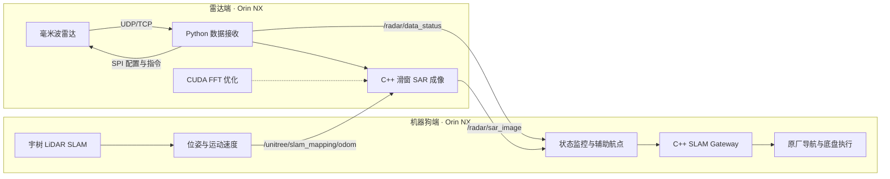
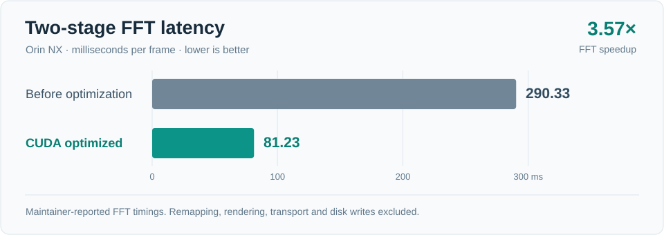

<p align="center">
  
</p>

<h1 align="center">Go2-W 机器狗感知与定位</h1>

<p align="center">面向移动机器人的毫米波雷达感知、SLAM 定位与边缘成像系统</p>

<p align="center">
  
  
  
  
  
</p>

<p align="center">
  <a href="#演示效果">演示效果</a> ·
  <a href="#系统架构">系统架构</a> ·
  <a href="#实测数据">实测数据</a> ·
  <a href="#快速开始">快速开始</a> ·
  <a href="docs/source-status.md">源码范围</a> ·
  <a href="README.en.md">English</a>
</p>

## 项目概述

本项目以 **宇树 Go2-W 轮足机器狗**为移动平台，基于双 **NVIDIA Orin NX** 构建机器狗总控与雷达感知系统。机器狗端提供 SLAM 位姿和运动信息，雷达端完成数据采集与滑窗 SAR 成像，再将采集状态和感知图像回传，用于障碍物相对位置分析与辅助航点设置。

系统复用宇树原厂 **LiDAR SLAM、重定位与导航能力**，毫米波雷达提供补充感知信息。项目重点是机器人运动数据与雷达感知结果的跨设备交互，以及成像计算在边缘设备上的部署与性能优化。

> **源码范围**：仓库提供 C++ SLAM Gateway、Python 边缘自治层和雷达 CPU 成像模块。下文整机系统中的 ROS2 雷达通信节点、障碍物坐标转换模块及 CUDA FFT 优化版本尚未收录。详见[源码与系统能力对应表](docs/source-status.md)。

## 演示效果

<table>
  <tr><th align="center">Go2-W 移动平台</th><th align="center">雷达感知模组</th></tr>
  <tr>
    <td align="center"></td>
    <td align="center"></td>
  </tr>
  <tr><th align="center">机器狗走廊行走片段</th><th align="center">雷达成像输出片段</th></tr>
  <tr>
    <td align="center"></td>
    <td align="center"></td>
  </tr>
</table>

素材来自项目实拍与运行记录，动图经过压缩和裁切，用于展示设备与输出形态，不作为定位精度、避障效果或端到端帧率的测量依据。

## 核心能力

| 方向 | 系统实现 |
| --- | --- |
| **定位与导航** | 复用宇树 LiDAR SLAM，获取位姿与运动信息，通过 C++ Gateway 对接建图、重定位、航点导航及暂停／恢复接口 |
| **ROS2 分布式通信** | 双 Orin NX 跨设备交换里程计、雷达采集状态与成像结果，连接机器人运动状态和雷达感知链路 |
| **雷达控制与采集** | SPI 配置雷达并下发指令，Python 完成 UDP/TCP 数据接收与采集记录 |
| **边缘成像** | 基于运动速度执行滑窗 SAR RDA 成像，完成距离向 FFT、方位向 FFT 和距离／方位重映射 |
| **计算优化** | 在 Orin NX 上分析各阶段耗时，使用 CUDA 优化 FFT 阶段，降低核心计算时延 |
| **辅助障碍感知** | 从二维成像结果提取障碍物相对位置，经坐标转换辅助设置航点，结合原厂导航完成简单避障 |

以上为整机项目能力，当前公开代码的对应范围见[源码说明](docs/source-status.md)。

## 系统架构



架构图描述整机集成关系。ROS2 跨设备桥接、CUDA FFT 和感知结果到航点的转换属于整机集成部分，目前未随源码快照发布。

| Topic | 方向 | 用途 |
| --- | --- | --- |
| `/unitree/slam_mapping/odom` | 机器狗端 → 雷达端 | 提供运动速度，作为滑窗成像输入 |
| `/radar/data_status` | 雷达端 → 机器狗端 | 回传采集状态，供机器人端监控 |
| `/radar/sar_image` | 雷达端 → 机器狗端 | 回传二维成像结果，供感知与辅助避障模块使用 |

定位数据流、坐标关系和接口核验方法见[系统架构说明](docs/architecture.md)。

## 实测数据

项目**已经进行 Orin NX 实机测试**，以下为维护者提供的整机测试汇总。FFT 耗时仅对应两级 FFT 阶段，包含重映射、渲染、传输及写盘的完整链路需单独计时。

| 指标 | 结果 |
| --- | ---: |
| 累计原始数据块 | **5,199 个** |
| 累计雷达数据量 | **约 10.90 GB** |
| 数据吞吐率 | **约 121.29 Mbps** |
| 采集记录 `bad_chirp` | **0** |
| 有效 SAR 图像 | **356 帧** |
| 优化前两级 FFT 平均耗时 | **290.33 ms/帧** |
| CUDA 优化后两级 FFT 平均耗时 | **81.23 ms/帧** |
| FFT 阶段加速比 | **约 3.57×** |

<p align="center"></p>

计时范围、质量字段和复现所需记录见[性能与测试口径](docs/benchmarks.md)。

## 仓库结构

```text
Go2W_SLAM_AI/
├── slam_gateway_cpp_sdk/       # C++：原厂 SLAM / 导航服务适配
├── go2w_edge_autonomy/         # Python：状态采集、地图与航点、任务入口
├── radar/
│   └── fft_image_NX_live/      # C++ CPU 成像、Python 采集启动与参数配置
├── examples/                  # 无需机器人即可使用的离线状态示例
└── docs/
    ├── architecture.md        # 双设备数据流与感知定位关系
    ├── getting-started.md     # 离线预览、机器人部署、雷达构建
    ├── benchmarks.md          # 实测指标与计时口径
    ├── source-status.md       # 整机能力与公开源码对应关系
    └── assets/                # 项目实拍、动图与图表
```

## 快速开始

### 1. 克隆项目

```bash
git clone https://github.com/Yincloudhub/Go2W_SLAM_AI.git
cd Go2W_SLAM_AI
```

### 2. 在普通电脑上预览任务转换

此示例使用合成状态和仓库中的地图样例，只打印任务计划与 SLAM JSON 命令。需要 Python 3.10 或更新版本。

```bash
python go2w_edge_autonomy/scripts/run_llm_nav_local.py \
  --command "去 wp_1" \
  --snapshot-json examples/offline_snapshot.json \
  --dry-run --pretty
```

默认分支的任务入口使用规则 planner；真实 LLM 集成开发保留在 [`agent/llm-on-robot`](https://github.com/Yincloudhub/Go2W_SLAM_AI/tree/agent/llm-on-robot) 分支。

### 3. 部署到机器人与雷达设备

在具备 Unitree SDK2 的机器狗 Linux 环境编译 Gateway：

```bash
cd slam_gateway_cpp_sdk
bash scripts/build_on_go2.sh
```

在安装 Eigen3、FFTW3、MATIO 和 OpenCV 的雷达端 Linux 环境编译成像模块：

```bash
cd radar/fft_image_NX_live
cmake -S . -B build -DCMAKE_BUILD_TYPE=Release
cmake --build build -j4
```

以上两个构建命令分别从仓库根目录执行。设备配置、输入数据格式与采集依赖见[部署指南](docs/getting-started.md)。

## 技术栈与模块入口

**C++17 · Python · ROS2 · Linux · NVIDIA Orin NX · CUDA · SPI · UDP/TCP · SAR RDA**

| 模块 | 入口 |
| --- | --- |
| 建图、定位与导航 Gateway | [slam_gateway_cpp_sdk](slam_gateway_cpp_sdk/README.md) |
| Python 状态与任务层 | [go2w_edge_autonomy](go2w_edge_autonomy/README.md) |
| 雷达采集与 CPU 成像 | [radar/fft_image_NX_live](radar/fft_image_NX_live/README.md) |
| 系统能力与源码发布范围 | [source-status](docs/source-status.md) |
