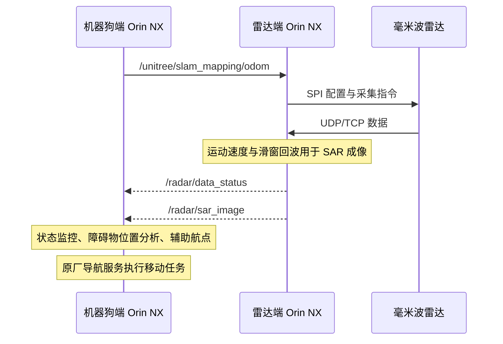
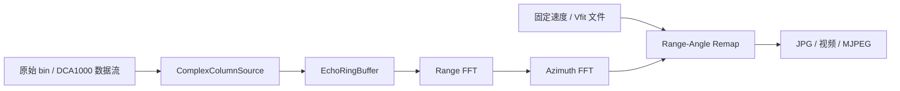

# 感知与定位系统架构

[返回项目首页](../README.md)

## 系统分工

整机采用双 Orin NX：机器狗端承载总控与 SLAM 服务交互，雷达端承载采集和成像。两端通过 ROS2 传递运动数据、采集状态与感知图像。

| 部分 | 输入 | 输出 | 职责 |
| --- | --- | --- | --- |
| 原厂 LiDAR SLAM | LiDAR 与原厂定位链路数据 | 地图、位姿、里程计、导航反馈 | 机器狗建图、定位和导航底座 |
| C++ SLAM Gateway | 结构化任务、原厂状态反馈 | SLAM API 调用、结构化状态 | 建图、重定位、航点导航、暂停与恢复的适配层 |
| Python 边缘自治层 | 状态快照、地图配置、任务输入 | 任务计划、Gateway JSON 命令 | 组织定位状态、地图与拓扑节点，生成上层任务 |
| 雷达采集层 | SPI 控制参数、UDP/TCP 数据 | 原始数据流、采集状态与日志 | 配置雷达、接收回波、记录采集过程 |
| 雷达成像层 | 滑窗回波、平台运动速度 | SAR 二维图像、阶段耗时 | 距离向 FFT、方位向 FFT、距离／方位重映射 |
| 整机辅助感知层 | 成像结果、机器人位姿、传感器外参 | 障碍物相对位置与辅助航点 | 将雷达感知信息用于简单避障 |

这里描述整机项目。各模块是否包含于当前仓库，见[源码范围](source-status.md)。

## 运动与感知数据流



## Topic 与数据含义

| Topic | 发布端 | 订阅端 | 数据用途 |
| --- | --- | --- | --- |
| `/unitree/slam_mapping/odom` | 机器狗 | 雷达 | 提取平台运动速度，支持运动条件下的滑窗成像 |
| `/radar/data_status` | 雷达 | 机器狗 | 监控采集状态 |
| `/radar/sar_image` | 雷达 | 机器狗 | 传递二维感知结果，供图像显示与障碍物位置分析 |

机器狗端现有 Python 状态采集还使用 `/unitree/slam_relocation/odom`、`/unitree/slam_lidar/points`、`/slam_info` 等接口。**建图里程计与重定位里程计是不同 Topic**，应根据机器狗当前运行模式核对实际发布情况。

雷达通信节点未随当前快照发布，消息类型、QoS、图像编码和时间戳约定应以整机节点为准。在设备上可检查：

```bash
ros2 topic info /unitree/slam_mapping/odom --verbose
ros2 topic type /radar/data_status
ros2 topic info /radar/sar_image --verbose
ros2 topic hz /radar/sar_image
```

## 定位与雷达空间信息的关系

SLAM 提供机器狗在地图中的位姿，SAR 成像提供雷达观测到的障碍物相对位置。将后者用于地图航点，需要雷达相对机体的安装外参，以及与该次观测对应的机器人位姿。

采用列向量、`T_A_B` 表示从 B 坐标系到 A 坐标系的变换时，关系可写为：

```text
p_map = T_map_base(t) × T_base_radar × p_radar
```

这是坐标关系说明。实际使用时还需核对雷达成像的距离与方位定义、坐标轴方向、长度单位及观测时间。当前公开快照未包含对应外参文件与坐标转换模块。

毫米波结果用于补充障碍感知与辅助航点，定位和导航执行继续使用宇树原厂能力。项目材料未提供雷达参与定位后的误差评估，因此这里不声明雷达 SLAM、融合定位精度或厘米级定位指标。

## 雷达源码内部链路



公开源码通过配置速度或 `Vfit` 文件提供运动参数。其 `FrameVelocityProvider` 接口可作为后续接入真实运动信息的入口，但当前没有 ROS2 里程计订阅实现。

## 进一步阅读

- [部署与离线预览](getting-started.md)
- [测试数据与性能口径](benchmarks.md)
- [源码与系统能力对应表](source-status.md)
